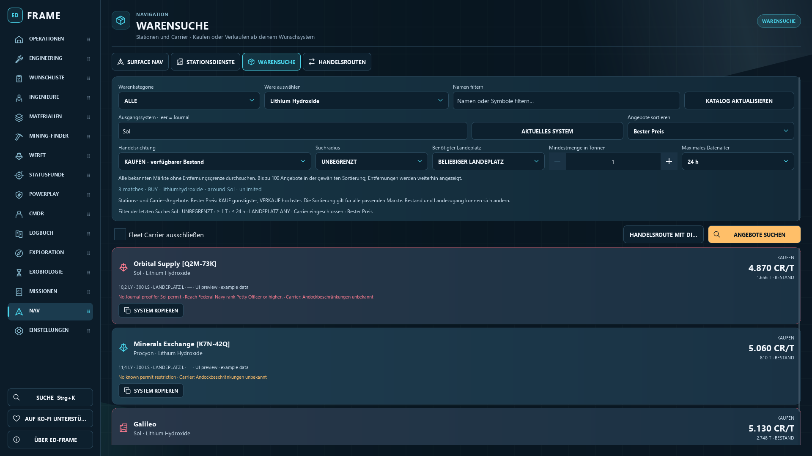
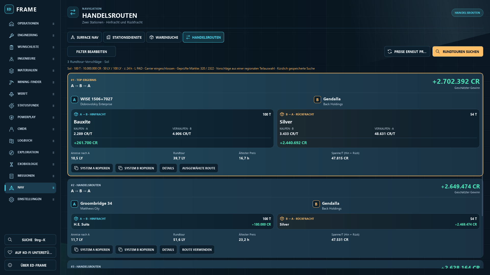
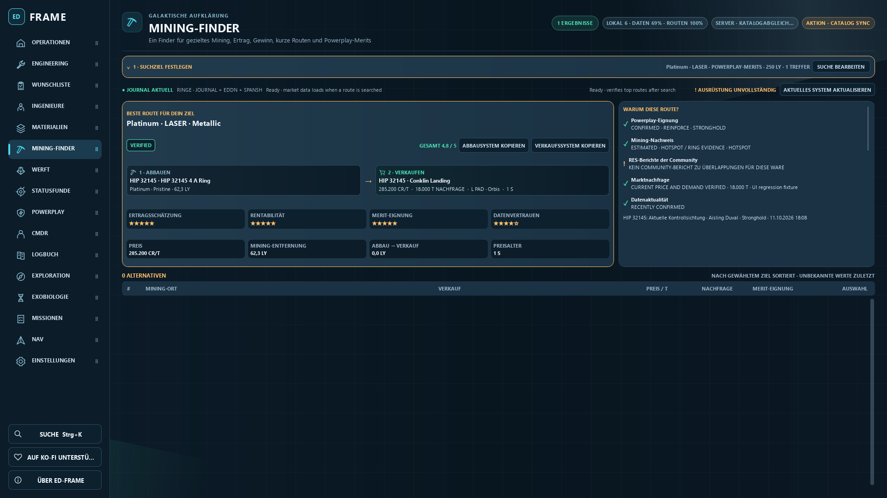
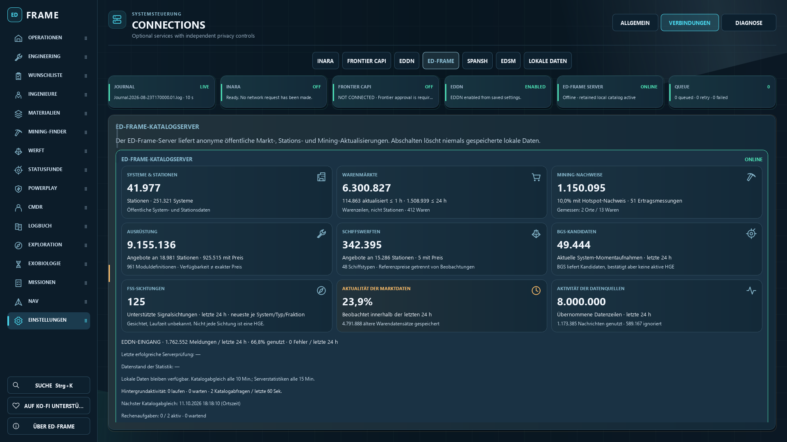
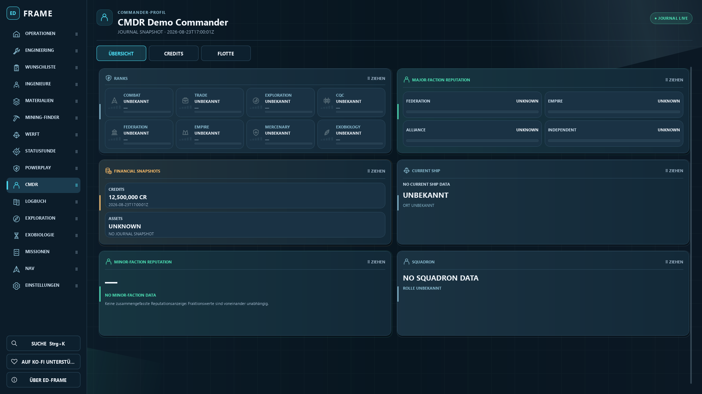

# ED-Frame: einheitliches Cockpit-Design
Stand: 11. Oktober 2026 · lokaler Teststand auf Basis von 1.0.8

Die native App verwendet jetzt eine gemeinsame Gestaltung: dieselben Karten,
Abstände, Piktogramme, Schriften, Schaltflächen und Farbbedeutungen. Die Umstellung
umfasst alle 18 Hauptbereiche einschließlich der Warensuche, Handelsrouten,
Stationsdienste, Serverübersicht und weiterer Unteransichten.

## Sichtbare Änderungen

- Gemeinsame Sidebar und Seitenköpfe mit eigenen SVG-Piktogrammen.
- Einheitliche Karten mit dezenten Farbverläufen und klarer Gewichtung der Zahlen.
- Cyan für Navigation/Auswahl, Grün für positive Ergebnisse, Amber für Hinweise
  und Rot für Einschränkungen. Fehlende oder unbekannte Angaben bleiben erkennbar.
- Warensuche: Angebote als Karten mit Preis, Bestand/Nachfrage, Entfernung,
  Landeplatz, Quelle und Zugangsangaben. Fleet Carrier haben ein eigenes Symbol.
- Mining: hervorgehobene Empfehlung und übersichtliche Mine-/Verkaufskarten.
- Rundtouren: getrennte Hin- und Rückfracht mit denselben Karten und Kopieraktionen.
- Serverübersicht: Piktogramme und besser gegliederte Statistik-Karten.
- Die NAVY-Palette entspricht dem Cockpit-Entwurf. Alle sechs Farbprofile bleiben
  verfügbar und verwenden dieselben Komponenten.

Als Schrift verwendet die App Segoe UI. Die bisher angegebene Schriftfamilie
„Segoe UI Variable Text“ wurde im Qt-Test auf diesem Rechner durch Consolas
ersetzt. Piktogramme sind lokale SVGs und hängen nicht von installierten
Symbolschriften ab.

Die Darstellung benötigt keine zusätzlichen Serverabrufe. Kartenverläufe sind
statisch; eine dauerhaft animierte Hintergrunddekoration wurde entfernt.
Es wurden keine neuen Effekte mit Blur oder Shadern eingeführt.

## Prüfung

**76 gezielte Tests bestanden**, darunter native QML-Prüfungen für alle
Hauptseiten bei 1920 × 1080 sowie 1120 × 700 mit deutscher Oberfläche und
115 % UI-Skalierung. Die sechs Farbprofile, vier Sprachen in den Handelsansichten,
Interaktionen und Layoutregeln wurden geprüft.

Die portable EXE hat **35 Funktionsprüfungen bestanden**, einschließlich Mining
und der Hintergrundprozesse für Journal- und Powerplay-Verarbeitung.
Die fünf zusätzlichen Ansichten mit gefüllten Beispieldaten bestanden
15 Prüfbereiche. Insgesamt wurden 52 App-Screenshots erstellt.

Die abschließende Prüfung der unbegrenzten Suche ist ebenfalls bestanden.
39 QML-/JS-/Sprachressourcen im Testpaket stimmen mit dem Quellstand überein.
Der SVG-Renderer ist enthalten; `git diff --check` hat keine Fehler gemeldet.
Tests verwendeten getrennte Profile und Software-Rendering.

Der persönliche Eindruck im Dauerbetrieb und auf anderen PCs bleibt Teil des
lokalen Praxistests. Automatische Prüfungen ersetzen diesen nicht.

## Lokaler Test

Testversion starten: `output/ED-Frame-Cockpit-Test-20261011-Windows/ED-Frame/ED-Frame.exe` (lokales Prüfartefakt)

Vorher die bisherige App vollständig schließen, auch im Tray. Dann die EXE aus
dem neuen Testordner starten und den Ordner vollständig zusammenlassen.
Unter Einstellungen **NAVY** auswählen, um die Cockpit-Farben zu sehen.
Das gespeicherte Farbprofil wird beibehalten.

Der Stand bleibt lokal; es wurde nichts veröffentlicht oder gepusht.
Die bisherigen lokalen Änderungen und der ältere Testordner bleiben erhalten.
Die angezeigte Versionsnummer bleibt 1.0.8.

## Vorschauen aus der nativen App

Die Bilder zeigen Testdaten bzw. einen bereits gespeicherten öffentlichen
Routenvorschlag. Sie sind keine aktuellen Live-Zahlen oder Preiszusagen.

### Warensuche

### Handelsrouten

### Mining

### Serverübersicht

### Commander

